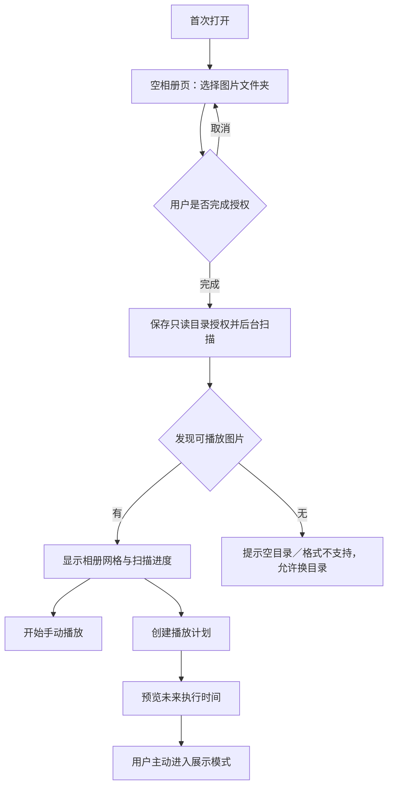
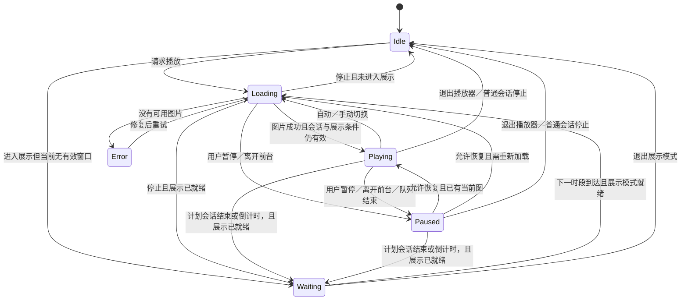
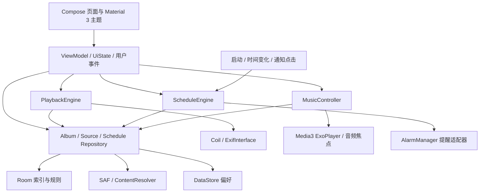

# 安卓平板电子相册完整方案

> 版本：V1.1 家庭离线版方案稿  
> 日期：2026-11-09  
> 目标：开发一款尽量兼容旧安卓平板的家庭离线电子相册，支持选择本地图片目录、全屏幻灯片、换片间隔、停止倒计时、每日／每周播放计划，以及指定音乐文件夹的循环／随机背景音乐，采用深色 Material You / Material 3 设计。  
> 范围约束：仅家庭自用；不联网，不接入云端，不做人脸识别，不播放视频，不设计企业管理功能。  
> 本文包含产品定义、交互、视觉规范、技术架构、数据设计、系统限制、开发阶段与验收标准，可直接作为毕业设计开发依据。

## 1. 总体方案与前提

采用 **Kotlin + Jetpack Compose + Material 3** 开发原生 Android 应用；以 **Android 5.0 / API 21** 为兼容目标，选择并锁定仍支持该版本的依赖组合。使用系统目录选择器分别授权图片和音乐目录，通过 URI 只读访问；Room 保存相册、图片／音乐索引与计划，DataStore 保存偏好；图片播放器、背景音乐与计划引擎独立于界面，以状态驱动 UI。

本方案默认以下产品决策，后续可根据实际平板调整：

| 项目 | 默认方案 |
| --- | --- |
| 应用暂名 | 暮光相册，可在开发时替换 |
| 主要设备 | 用户现有的华为 M5，HarmonyOS 2.0.0；优先在该设备验收，同时兼容其他旧安卓平板 |
| 最低系统 | 以 Android 5.0 / API 21 为开发和验收目标；须通过完整依赖图、安装与真机测试确认 |
| 主要交互 | 触摸；兼容键盘方向键、空格键与返回键 |
| 图片来源 | 本机共享存储、通过系统文档提供者暴露的 SD 卡／U 盘目录 |
| 使用范围 | 家庭自用，本地安装 APK，单设备管理 |
| 网络 | 完全离线，无账号、云同步、广告、在线音乐或联网更新；不声明网络权限 |
| 文件操作 | 只读原图与音乐，移除相册或来源不会删除原文件 |
| 背景音乐 | 每个相册可指定一个本地音乐文件夹；支持顺序循环与随机循环，跟随幻灯片启停 |
| 主题 | 默认深色；Android 12+ 可启用系统动态配色，旧系统使用固定深色配色 |
| 显示方式 | 横竖屏均可用，按窗口大小自适应；播放时图片占据主要空间 |
| 定时能力 | 换片间隔、停止倒计时、每日／每周时间窗；分别命名和设置 |

**家庭版保留清楚的系统边界：不能通用地保证锁屏后准点点亮屏幕、越过锁屏并自动播放。** 提供“省电模式”和“常驻展示模式”：前者允许系统熄屏，后者在前台保持亮屏、在计划外显示低亮度待机画面并停止音乐。即使兼容旧系统，也不依赖 Root、设备管理权限或后台强拉界面。依据：[后台 Activity 启动限制](https://developer.android.com/guide/components/activities/secure-bal)、[保持屏幕亮起](https://developer.android.com/develop/background-work/background-tasks/awake/screen-on)。

华为官方支持资料将 HarmonyOS 2.0 列入手机／平板的应用安装适用版本，支持本方案沿 Android APK 路线开发；但本项目尚未取得这台 M5 的运行信息或完成实机安装，不能把 HarmonyOS 2.0.0 直接等同于某个 Android API 等级。建项后用最小测试 APK 读取 `Build.VERSION.SDK_INT` 并验证目录选择和音频解码，再锁定最终适配清单。依据：[华为应用安装说明](https://consumer.huawei.com/cn/support/content/zh-cn00766399/)、[Build.VERSION](https://developer.android.com/reference/android/os/Build.VERSION)。

## 2. 使用场景与范围

### 2.1 核心场景

1. 用户将照片放到平板的 `Pictures/电子相册` 等目录，打开应用并授权该目录。
2. 应用扫描照片，显示缩略图、数量和来源状态；用户设置顺序、间隔和转场。
3. 点击“开始播放”，进入全屏幻灯片，可暂停、上一张、下一张和设置停止倒计时。
4. 用户创建“每天 08:00—22:00”或“周一至周五 19:00—23:00”等播放计划。
5. 用户主动进入常驻展示模式；在有效时段播放，时段外显示低亮度待机。
6. 新照片加入目录后，通过刷新、回到前台检查或提供者变化通知更新图库。
7. 用户选择 `Music/相册配乐` 等音乐文件夹，设置顺序循环或随机循环；相册播放时同时响起配乐，停止、退出或所属计划会话结束后音乐停止。

### 2.2 第一版交付范围

| 模块 | 第一版必须实现 | 后续可选扩展 |
| --- | --- | --- |
| 目录与相册 | 多目录、包含子目录开关、目录状态、重新授权、多相册 | 单张照片选择导入、系统全图库入口 |
| 图片浏览 | 缩略图网格、排序、单图预览、加载／空／错误状态 | 搜索、收藏、照片排除列表 |
| 幻灯片 | 顺序／随机、循环、间隔、完整显示／裁切、淡入淡出／无转场 | 缓慢平移缩放、多图拼贴 |
| 背景音乐 | 选择音乐文件夹、扫描歌曲、顺序循环／随机循环、音量、上一首／下一首、单独静音 | 不扩展在线音乐或独立后台音乐播放器 |
| 定时 | 停止倒计时、每日／每周时间窗、跨午夜、冲突校验 | 多时区规则、节假日例外 |
| 展示模式 | 前台播放、低亮度待机、省电停止、手动覆盖规则 | 仅保留家庭用途 |
| 后台提醒 | 可选非精确提醒、通知权限状态、点击进入 | 有明确需求后再评估精确提醒 |
| 外观 | 深色 Material 3、动态配色、平板自适应、基础无障碍 | 更多主题、时钟样式 |

背景音乐纳入第一版必做范围。视频、云端联网、人脸识别与企业功能均排除；照片编辑不纳入第一版。

## 3. 信息架构与主要流程

### 3.1 页面结构

```text
应用
├── 相册
│   ├── 相册列表／最近使用
│   ├── 相册详情：照片网格、来源摘要、播放操作
│   ├── 目录管理：添加、移除、包含子目录、刷新、重新授权
│   ├── 播放设置：顺序、间隔、转场、显示方式
│   ├── 背景音乐：文件夹、顺序循环／随机循环、音量、歌曲列表
│   └── 单图预览／全屏播放器
├── 定时
│   ├── 播放计划列表与启用开关
│   ├── 新建／编辑计划
│   ├── 下次开始／结束与最近执行记录
│   └── 进入展示模式
└── 设置
    ├── 外观：动态配色、固定主题色
    ├── 展示：省电／常驻、亮度、时钟、控制条
    ├── 兼容与性能：精简效果、图片采样、预加载策略
    ├── 存储：图片／音乐索引状态、缓存大小、清理缓存
    ├── 提醒：开关、权限和渠道状态
    └── 关于：版本、隐私说明、开源许可
```

一级导航固定为“相册、定时、设置”。“开始播放”为相册页主要操作；“进入展示模式”为定时页主要操作，二者在界面中明确区分。

背景音乐属于相册配置，不增加独立一级导航。音乐面板显示所选文件夹、曲目数量、播放方式、当前曲名、上一首／下一首和音量；窄窗口使用底部弹层，宽窗口可放入详情区。

### 3.2 首次使用



首次启动只请求目录访问；用户开启后台提醒时才请求通知权限。拒绝提醒不影响读图、幻灯片和前台计划。

### 3.3 添加目录

1. 点击“添加文件夹”，打开系统目录选择器。
2. 用户选择本机或 SD 卡中的照片目录，确认授权。
3. 显示目录名称、“包含子文件夹”开关和所属相册；默认包含子目录。
4. 立即显示扫描状态，已扫描出的照片可逐批展示，不等待整批完成。
5. 扫描结束显示图片数量、跳过文件数量和“刷新”入口。
6. 同一目录重复添加时提示已存在；父子目录重叠时允许保留来源，但播放列表对同一图片去重。

## 4. 深色 Material You / Material 3 设计规范

### 4.1 视觉方向

界面采用低亮度中性底色、柔和主题色、圆角容器和清楚的文字层级。图片内容是主角：主题色主要用于按钮、选择态和进度，播放画布保持中性深色，避免色偏干扰照片。

以 Material 3 的颜色角色、字阶、形状和组件为基础，不只给普通界面换成黑底。Android 12+ 的动态配色从系统壁纸提取色系，使用深色方案；提供开关，关闭后回退固定主题。依据：[Compose Material 3](https://developer.android.com/develop/ui/compose/designsystems/material3)。

### 4.2 固定深色回退配色

以下为本项目建议值，属于设计起点；最终需结合组件状态和对比度验收。

| Material 颜色角色 | 建议值 | 用途 |
| --- | --- | --- |
| `background` / `surface` | `#141218` | 页面基础背景 |
| `surfaceContainerLow` | `#1D1B20` | 次级容器 |
| `surfaceContainer` | `#211F26` | 卡片、设置分组 |
| `surfaceContainerHigh` | `#2B2930` | 对话框、悬浮工具条 |
| `primary` / `onPrimary` | `#D0BCFF` / `#381E72` | 主要按钮、选中状态 |
| `primaryContainer` / `onPrimaryContainer` | `#4F378B` / `#EADDFF` | 选中导航、重要容器 |
| `secondary` / `onSecondary` | `#CCC2DC` / `#332D41` | 次级操作 |
| `onSurface` | `#E6E0E9` | 主要文字 |
| `onSurfaceVariant` | `#CAC4D0` | 说明文字、次级图标 |
| `outline` | `#938F99` | 控件边线 |
| `error` / `onError` | `#F2B8B5` / `#601410` | 授权失效、执行失败 |
| 播放画布 | `#08090B` | 不随动态配色改变 |

其余颜色角色由统一的 `ColorScheme` 补全，避免各页面散落硬编码颜色。动态配色开启时使用系统色系，保留中性播放画布与清晰的错误语义。

### 4.3 字体、尺寸与组件

| 项目 | 规则 |
| --- | --- |
| 字体 | 系统中文字体；文字尺寸使用 sp，尊重系统字号 |
| 标题 | 页面标题建议 `headlineSmall`；分组标题 `titleMedium` |
| 正文 | `bodyLarge` / `bodyMedium`，说明使用 `bodyMedium` |
| 时间 | 播放计划时间建议 28～32sp；跟随系统 12／24 小时制 |
| 间距 | 4dp 基础网格，常用 8／12／16／24／32dp |
| 页面边距 | 窄窗口 16dp，宽窗口 24～32dp |
| 圆角 | 图片卡片 16dp，主要容器 24dp，按钮遵循 Material 3 默认形状 |
| 触控 | 主要交互区域至少 48×48dp；小图标扩大可点击范围 |
| 图标 | 统一 Material 风格，配文字或无障碍标签 |
| 反馈 | 普通成功使用 Snackbar；授权失效等持续问题使用页面内提示 |

推荐组件：`TopAppBar`、`FilledTonalButton`、`FloatingActionButton`、`FilterChip`、`Switch`、`Slider`、`TimePicker`、`AlertDialog`、`ModalBottomSheet`。导航根据窗口宽度切换 `NavigationBar` / `NavigationRail`；仅在依赖最低版本校验通过时使用 `NavigationSuiteScaffold` 等套件。具体 API 以锁定版本为准，不为视觉效果升级到不兼容旧系统的库。

### 4.4 平板自适应布局

按**当前可用窗口**判断布局，不能只根据物理平板尺寸或横竖屏判断。

| 窗口宽度 | 导航与布局 | 图片网格 |
| --- | --- | --- |
| 小于 600dp | 底部导航，单栏；设置和详情独立页面 | 按最小卡片宽度自适应 |
| 600～839dp | 高度充足时侧边导航；网格为主，详情按需展开 | 通常 3～4 列，依实际空间调整 |
| 不小于 840dp | 侧边导航＋主内容＋详情／播放设置双栏 | 按主内容宽度自适应 |
| 宽但高度很低 | 精简顶部区域，保证操作可滚动；允许导航回退 | 减少装饰和预览占位 |

建议缩略图最小宽度约 144dp；双栏详情区建议 300～360dp，空间不足时折叠。窗口分类还应考虑高度和设备姿态；可以用现有 Compose 约束实现，不依赖最新 Adaptive 库。依据：[自适应导航](https://developer.android.com/develop/adaptive-apps/guides/build-adaptive-navigation)。

不将“强制横屏”作为关键功能依赖。面向 API 36／37 的大屏应用需适应系统对方向、尺寸和宽高比限制的调整，旋转与分屏后保留照片、暂停状态和编辑内容。依据：[大屏方向与可调整大小规则](https://developer.android.com/develop/adaptive-apps/guides/app-orientation-aspect-ratio-resizability)。

### 4.5 关键页面线框

宽窗口相册页：

```text
┌──────┬──────────────────────────────────┬──────────────────────┐
│ 相册 │ 家庭回忆                 添加目录 │ 相册预览              │
│      │ 3 个目录 · 1,248 张 · 已更新      │ [当前封面]            │
│ 定时 │ [文件名↑] [包含子目录] [刷新]    │ 家庭回忆              │
│      ├──────────────────────────────────┤ 10 秒 / 张 · 淡入淡出 │
│ 设置 │ [照片] [照片] [照片] [照片]      │ 顺序循环 · 完整显示   │
│      │ [照片] [照片] [照片] [照片]      │ [播放设置]            │
│      │ [照片] [照片] [照片] [照片]      │ [▶ 开始播放]          │
└──────┴──────────────────────────────────┴──────────────────────┘
```

播放计划页：

```text
┌───────────────────────────────────────────────────────────────┐
│ 播放计划                                      ＋ 新建计划     │
│ ┌───────────────────────────────────────────────────────────┐ │
│ │ 08:00 — 22:00                                    [启用]  │ │
│ │ 每天 · 家庭回忆 · 下次开始：明天 08:00                    │ │
│ └───────────────────────────────────────────────────────────┘ │
│ ┌───────────────────────────────────────────────────────────┐ │
│ │ 22:00 — 次日 07:00                               [停用]  │ │
│ │ 周五、周六 · 风景集 · 与上方计划重叠时不能同时启用        │ │
│ └───────────────────────────────────────────────────────────┘ │
│ 常驻展示：计划外低亮度待机，屏幕仍保持开启                     │
│                                          [进入展示模式]       │
└───────────────────────────────────────────────────────────────┘
```

播放器：照片全屏展示；控制层默认数秒后隐藏。

```text
┌───────────────────────────────────────────────────────────────┐
│ ‹ 家庭回忆                128 / 1248                 更多 ⋮   │
│                                                               │
│                           照 片                               │
│                                                               │
│          上一张        暂停／继续        下一张                 │
│ 文件名                  [音乐：曲名／静音] [倒计时] [设置]  │
└───────────────────────────────────────────────────────────────┘
```

## 5. 本地目录与图片读取

### 5.1 “可选路径”的正确实现

使用 Storage Access Framework（SAF）的 `ACTION_OPEN_DOCUMENT_TREE` 选择目录。界面向用户展示目录名称和可理解的来源说明；内部保存 `content://` URI，不要求用户手输 `/storage/emulated/0/...`，也不尝试从 URI 推导真实绝对路径。

完成选择后，从返回结果中提取实际获得的读取授权并调用 `takePersistableUriPermission`。应用只申请读取，不申请写入；通过 `ContentResolver` 查询和打开图片。持久授权可以跨重启，但移动、删除、撤销授权或存储离线仍需处理。依据：[SAF 目录授权](https://developer.android.com/training/data-storage/shared/documents-files)。

图片与音乐目录选择请求均设置 `Intent.EXTRA_LOCAL_ONLY=true`，只引导选择本机、SD 卡或已接入的本地存储。该标记不能约束所有第三方提供者的行为；不支持云来源，也不为其设计联网下载流程。依据：[EXTRA_LOCAL_ONLY](https://developer.android.com/reference/android/content/Intent#EXTRA_LOCAL_ONLY)。

### 5.2 目录限制与权限策略

Android 11+ 对目录选择有保护限制，包括内部存储根目录、部分 SD 卡卷根目录、Download 根目录及 `Android/data`、`Android/obb` 等目录。首次引导建议使用 `Pictures/电子相册` 等专用子目录，不能承诺任意路径可读。依据：[Android 11 存储限制](https://developer.android.com/about/versions/11/privacy/storage)。

| 权限／能力 | 第一版策略 |
| --- | --- |
| SAF URI 读取授权 | 必需，按用户选定目录获得 |
| `READ_MEDIA_IMAGES` | 纯 SAF 目录模式不需要 |
| `READ_MEDIA_AUDIO` | 通过用户授权的 SAF 音乐目录读取，不需要 |
| `READ_EXTERNAL_STORAGE` | 不作为 SAF 模式的前置条件 |
| `MANAGE_EXTERNAL_STORAGE` | 不申请全盘访问 |
| 写入、修改、删除原图／音乐 | 不申请，不提供 |
| `INTERNET` / `ACCESS_NETWORK_STATE` | 家庭离线版不声明，检查合并后的 Manifest；外部提供者不受本应用权限控制 |
| 照片位置权限 | 不作为播放或读取拍摄日期的前置条件 |

图片和音乐统一实现 SAF 主路径，不依赖 Photo Picker、新版全图库授权或 Google Play 服务；在 Android 5.0 起可使用目录授权入口。家庭版始终围绕用户指定文件夹工作。依据：[SAF 目录访问](https://developer.android.com/training/data-storage/shared/documents-files)。

### 5.3 扫描流程

```text
验证来源可访问
  → 遍历目录元数据
  → MIME／扩展名筛选
  → 生成稳定图片标识并去重
  → 分批更新 Room 索引
  → 按需加载缩略图和 EXIF
  → 成功完成后提交删除差异
  → 通知 UI 与后续播放列表更新
```

实现要求：

- 扫描运行在 IO 协程；查询子目录时尽量一次取得名称、类型、大小、修改时间和标识。
- 递归遍历使用队列与 visited 集，支持取消；逐批写库，例如每 100～300 条提交一次。
- 使用 `authority + documentId` 作为同一文档提供者内的去重键；文档标识按不透明字符串处理。
- 维护“来源—图片”关系，父子目录重复授权时同一图片只播放一次；不同提供者的内容副本不默认做耗时哈希去重。每个关系保存基于该来源授权生成的可读文档 URI，不能将去重后的全局唯一 URI 当作永久有效访问入口。
- MIME 优先、扩展名兜底，实际解码决定最终是否可播放；不因文件名以 `.jpg` 结尾就保证有效。
- 隐藏文件默认跳过，提供显示开关；目录名／文件名按提供者返回的信息判断，不假设所有提供者都有 Unix 隐藏属性。
- 拍摄时间、修改时间、尺寸和大小允许缺失，界面显示未知或使用明确回退值。
- 扫描失败、取消或 SD 卡拔出时不清空旧索引；只有扫描完整成功后才能清理该来源的失效关系。
- 不在初次扫描中解码所有原图或读取所有完整 EXIF；先保证可浏览，再按需补齐。

文档字段和标识规则参考：[DocumentsContract.Document](https://developer.android.com/reference/android/provider/DocumentsContract.Document)。

### 5.4 新增、删除与可移除存储

采用“手动刷新＋回到前台检查＋提供者支持时监听”的组合。`ContentObserver` 作为刷新提示，不能承诺所有 SAF 提供者都会递归、实时报告变化；任意 `content://` 来源也不能直接套用 `FileObserver`。依据：[DocumentsProvider 变化通知机制](https://developer.android.com/reference/android/provider/DocumentsProvider#queryChildDocuments(java.lang.String,java.lang.String%5B%5D,java.lang.String))。

- 新增图片：刷新后入库，在当前图片显示结束后的安全边界更新播放列表。
- 删除当前图片：保留已经解码的画面直到切换，之后跳过失效项。
- 目录暂不可用：显示“存储设备未连接”，保留来源和索引，允许重试。
- 授权确实失效：显示“需要重新授权”，提供选择目录入口。
- 移除来源：解除本应用引用，检查是否仍被其他相册引用；不删除原图。
- 同一 URI 被多个相册使用时，最后一个引用移除后才释放不再需要的持久授权；父子授权按实际 grant 关系管理。

### 5.5 格式与方向

首版重点支持 JPEG、PNG、静态 WebP；GIF 默认作为静态图片处理。HEIF／HEIC、AVIF 等按系统解码能力检测并实测，失败时给出格式提示，不宣称所有安卓版本一致支持。RAW、视频和 SVG 不纳入首版承诺。

使用 AndroidX `ExifInterface` 按需读取拍摄时间与方向；覆盖旋转和镜像。若图片加载库已处理方向，不再二次旋转。不同读取任务使用独立流或文件描述符并及时关闭。依据：[ExifInterface](https://developer.android.com/reference/androidx/exifinterface/media/ExifInterface)。

## 6. 幻灯片播放设计

### 6.1 默认设置

| 设置项 | 默认值 | 可选范围／规则 |
| --- | --- | --- |
| 换片间隔 | 10 秒 | 3／5／10／15／30／60 秒；自定义 1～3600 秒 |
| 排序 | 文件名自然升序 | 文件名、拍摄时间、修改时间；均可倒序 |
| 随机播放 | 关闭 | 开启后每轮洗牌，轮内不重复 |
| 循环 | 开启 | 关闭后最后一张保持显示并进入暂停 |
| 转场 | 淡入淡出，500ms | 无转场／淡入淡出；实际时长不得超过间隔的一半 |
| 显示方式 | 完整显示 Fit | 填满裁切 Crop，可明确预览裁切结果 |
| 留白 | 中性深色 | 可选低分辨率模糊填充，低内存设备关闭 |
| 控制条 | 操作后约 4 秒隐藏 | 暂停、菜单打开或辅助功能聚焦时保持可见 |
| 时钟／日期 | 默认关闭 | 用户主动启用，不改变原图 |
| 恢复 | 保存最后照片和播放配置 | 冷启动显示恢复入口，不擅自播放 |

拍摄时间缺失时回退修改时间，再按文件名和稳定 ID 排序；拍摄时间无时区时按“来源未标注时区”的本地时间处理，避免伪装成精确全球时间。

### 6.2 控制交互

- 单击画面显示／隐藏控制层；点击按钮只执行对应动作，避免事件穿透。
- 水平滑动上一张／下一张，滑动完成后重置该张停留计时。
- 点击暂停冻结换片剩余时间；继续后从剩余时间运行。
- 方向键切换，空格键暂停／继续；键盘焦点可见。
- 返回键先关闭菜单／弹层，再退出播放器并暂停；不强制接管系统返回。
- 从计划播放中退出或停止时抑制当前这一次计划，避免立即被重新拉回播放。
- 图片加载失败记录原因并跳过；一轮所有候选均失败时停止并提示修复来源，不无限高速重试。

### 6.3 播放状态机



运行状态另带 `sessionMode = MANUAL | SCHEDULED`、`displayArmed`、`pauseReason = USER | LIFECYCLE | END_OF_QUEUE` 和当前计划 occurrence 标识；这些不强行塞进所有状态枚举，避免状态数量膨胀。计划结束事件仅对 `SCHEDULED` 会话有效；停止后已进入展示则为 `Waiting`，普通会话则回到 `Idle` 并允许系统熄屏。进入下一窗口还必须确认没有对应的手动抑制记录。

用户暂停必须通过用户继续或下一计划窗口解除；生命周期暂停只在原会话仍存在、应用重新可见、未锁屏、倒计时未过期且计划仍有效时自动恢复。界面重建不新建会话，冷启动仍遵循主动恢复入口。

队列结束导致的暂停不随生命周期自动恢复；用户可切到其他图片或点击“重新播放”从首张开始。Loading 状态收到暂停或停止时取消请求并递增会话／加载代次；异步成功回调必须核验目标 ID、代次、暂停原因和展示条件，才能进入 Playing。

### 6.4 计时与并发规则

1. 停留计时从当前图片成功显示、入场转场结束后开始；默认停留 10 秒不包含额外解码等待和入场转场。
2. 自动切换和手动切换均通过唯一事件入口；播放器同时最多有一个换片计时任务。
3. 快速连续切图取消过时请求；用请求代次或目标 ID 校验结果，旧加载完成不能覆盖新图。
4. 切图期间保留上一张，避免空白闪烁；下一张失败则继续寻找，超时后显示清晰的错误反馈。
5. 换片与停止倒计时使用单调时钟计算剩余时间，避免用户调整系统时间导致跳片。
6. 锁屏或不再满足展示条件时暂停换片，不在后台继续解码；短暂系统弹窗与应用进入后台应分别处理。
7. 只有一张图片时保持显示，不反复转场；随机模式使用每轮洗牌，下一轮首张避免等于上一轮末张。
8. 扫描结果先形成新索引版本，再在切片边界调整队列；删除项跳过，新增项顺序模式按配置合并、随机模式从下一轮加入。

### 6.5 图片解码与内存

使用 Coil 的 Compose 加载能力，按实际显示约束请求目标尺寸；不批量加载原始分辨率。网格使用缩略尺寸，播放器默认只预加载下一张，过渡期保留必要的前后两张。依据：[Coil Compose](https://coil-kt.github.io/coil/compose/)。

ARGB_8888 图片的像素内存可近似为 `宽 × 高 × 4` 字节；例如 8000×6000 原图约占 183MiB，不能仅依据 JPEG 文件大小估算运行内存。限制内存缓存预算、取消离屏请求、在内存紧张时降低采样和关闭模糊背景。依据：[大图加载建议](https://developer.android.com/topic/performance/graphics/load-bitmap)。

建议初始缓存策略为：共享图片加载器；内存缓存不超过应用内存等级约 15%～20%，并设置可调整上限；本地缩略图磁盘缓存约 200MiB，可清理。具体值通过目标平板实测确定，不视为所有设备都适用的固定指标。

旧平板默认采用更保守的精简档：禁用模糊背景和持续缩放动画，转场为无或简单淡入淡出；解码尺寸不大于实际画布，预加载最多一张，低内存时关闭预加载。音乐只流式解码当前曲目，不把整首音频读取为内存数组。

## 7. 本地背景音乐设计

### 7.1 音乐来源与默认配置

每个相册可指定一个音乐文件夹，和图片文件夹分别选择；不要求放在同一位置。音乐配置随相册保存，定时计划使用目标相册的音乐配置快照。

| 设置项 | 默认值 | 行为 |
| --- | --- | --- |
| 背景音乐 | 未配置时关闭 | 选定有效目录后由用户开启 |
| 音乐文件夹 | 用户通过系统目录选择器指定 | 本机、SD 卡或本地可移除存储 |
| 包含子目录 | 关闭 | 开启后递归读取目录下的音频 |
| 播放方式 | 顺序循环 | 可切换随机循环，与图片随机设置相互独立 |
| 顺序依据 | 文件名自然升序 | 例如 1、2、10，不按字符串排成 1、10、2 |
| 配乐音量 | 播放器增益 35% | 用户可调 0～100%；叠加系统媒体音量，不擅自修改系统音量 |
| 当前曲目 | 显示标题，缺失时用文件名 | 提供上一首、下一首、音乐暂停／继续 |
| 转场与音效 | 不做歌曲交叉混音或均衡器 | 旧平板优先降低解码负担 |

SAF 返回的 `content://` 直接构建音频 `MediaItem`，由 Media3 ExoPlayer 读取，不转换真实路径，不复制整首音频。通过授权音乐目录读取不需要额外的全图库音频权限。依据：[DefaultDataSource](https://developer.android.com/reference/androidx/media3/datasource/DefaultDataSource)、[SAF](https://developer.android.com/training/data-storage/shared/documents-files)。

### 7.2 循环与随机的明确语义

**顺序循环**：按文件名自然排序播放整个目录，最后一首结束后回到第一首；实现使用 `REPEAT_MODE_ALL`，关闭播放器 shuffle。

**随机循环**：每轮将当前可用曲目洗牌，轮内每首播放一次；整轮结束后重新洗牌，有两首及以上时避免新一轮首曲与上一轮末曲相同。只有一首有效音乐时循环该曲。

为兑现每轮重新随机，随机模式由 `MusicQueueBuilder` 维护轮次、随机种子和队列，ExoPlayer 播放本轮完整队列，设置 `REPEAT_MODE_OFF`、关闭内置 shuffle；收到本轮结束事件后生成下一轮。用户点击下一首是主动跳过，可在本轮不再返回该曲；上一首按本会话历史回退，属于用户主动重听。切换模式时保留当前曲目与播放进度，只重建后续队列。

Media3 内置 shuffle＋列表循环会重复同一预计算随机顺序，不能直接视为每轮重新洗牌。本方案使用应用层队列明确控制语义。依据：[播放列表与 shuffle](https://developer.android.com/media/media3/exoplayer/playlists)。

刷新发现新曲目时，顺序模式在当前曲结束后的安全边界合并；随机模式在下一轮加入。删除或无法打开的曲目从有效队列剔除，扫描失败时不清空原索引。

### 7.3 与幻灯片和定时联动

“背景音乐”指相册展示时的配乐，不代表应用切后台后继续播放的独立音乐播放器。

| 相册／系统事件 | 音乐行为 |
| --- | --- |
| 手动播放／计划进入播放 | 已开启且存在有效曲目时启动音乐；无音乐时照片照常播放 |
| 自动或手动切换照片 | 音乐持续，不随每张照片重新开始 |
| 暂停幻灯片 | 音乐同时暂停，保留曲目和进度 |
| 继续幻灯片 | 恢复之前因联动暂停的音乐；用户单独暂停或耳机断开的抑制不自动解除 |
| 用户单独暂停音乐／音量设为零 | 图片继续播放；之后切图、调度刷新不能擅自恢复出声 |
| 非循环图片队列结束 | 暂停音乐；用户重新播放图片后按联动规则恢复 |
| 一张图片且循环开启 | 保持照片显示，音乐正常轮播 |
| 倒计时到期／所属计划会话结束／进入待机 | 停止当前音乐会话，不在低亮度待机时继续响；其他计划的边界不打断手动会话 |
| 退出播放器／切换相册 | 停止旧音乐会话；新相册按其独立配置播放 |
| 应用切后台／锁屏 | 暂停并保留短期进度，释放不需要的解码资源；不启动后台播放服务 |
| 返回前台 | 先核对原会话、倒计时和计划；满足恢复条件才继续，过期不出声 |
| 冷启动／设备重启 | 恢复配置和恢复入口，不自动播放声音 |
| 图片目录全部不可读 | 停止相册会话并停止音乐，不形成独立音乐播放 |
| 音乐目录为空／撤权／SD 卡断开 | 仅停止音乐，照片继续；显示修复入口，不让配乐故障阻塞展示 |

音乐与图片拥有独立队列和时间轴，不按换片间隔切歌。保存短期进度时用曲目 ID、毫秒位置、模式、轮次和暂停原因，不持久化播放器实例；屏幕旋转和短暂窗口重建不将歌曲从头重播。

### 7.4 音频焦点、耳机与异常处理

- 设置 `USAGE_MEDIA`、`CONTENT_TYPE_MUSIC`，优先让 ExoPlayer 自动管理音频焦点，避免重复实现两套焦点请求。
- 系统需要降音时遵守降音；临时失去焦点只在原会话仍有效时恢复。永久丢失焦点后不循环抢回，提供音乐继续按钮。
- 启用音频输出变更处理，如 `setHandleAudioBecomingNoisy(true)`；耳机断开或切换输出触发暂停后，需用户确认继续，避免突然外放。不增加蓝牙扫描权限。
- 针对较高 targetSdk 的音频焦点限制，只在应用满足前台条件时申请；照片已处于播放状态也不能代替音频焦点授权。
- 单曲格式不支持、损坏或 URI 失效时跳过并记录；本轮所有候选失败时关闭本次音乐播放并提示，避免无限重试。
- 音频暂停原因单独记录，例如用户、相册联动、生命周期、音频焦点和耳机断开；自动恢复不得清除用户意图。
- 第一版不做持续后台音频，不创建 `MediaSessionService`，不申请音乐前台服务权限。音乐播放器由展示会话管理，离开后释放；配置变化按会话恢复。

依据：[音频焦点规则](https://developer.android.com/media/optimize/audio-focus)、[ExoPlayer.Builder](https://developer.android.com/reference/androidx/media3/exoplayer/ExoPlayer.Builder)、[ExoPlayer 创建与释放](https://developer.android.com/media/media3/exoplayer/hello-world)。

### 7.5 旧设备格式与本地文件约定

优先使用 MP3、AAC-LC 编码的 M4A／AAC、PCM WAV；Ogg Vorbis、FLAC 等作为目标设备实测支持项。容器扩展名不等于编码保证，不承诺所有 M4A、无损格式、WMA／APE 或受 DRM 保护文件可播，也不引入在线解码和庞大的额外转码组件。依据：[Android 支持的媒体格式](https://developer.android.com/media/platform/supported-formats)。

示例家庭目录：

```text
Pictures/电子相册/     ← 图片来源
  旅行/001.jpg
  家人/002.jpg
Music/相册配乐/       ← 音乐来源
  01-钢琴.mp3
  02-轻音乐.m4a
  03-环境音.mp3
```

扫描只读取曲目清单与必要元数据，时长和标签可延后补齐；不为背景音乐解析全部封面大图。图片和音乐共用底层授权管理，但分别过滤类型，歌曲路径不混入照片队列。

## 8. 定时功能完整设计

### 8.1 三类时间分别处理

| 功能 | 用户入口 | 时间依据 | 到期行为 |
| --- | --- | --- | --- |
| 换片间隔 | 相册的播放设置 | 前台单调时钟 | 显示下一张 |
| 停止倒计时 | 播放器控制条 | 现实经过时间 | 停止当前会话，并抑制当前计划 occurrence |
| 播放计划 | 定时页 | 系统日期、当地时间和时区 | 展示模式中开始／结束指定相册 |

禁止用一个模糊的“定时”开关混合三类语义。

### 8.2 停止倒计时

- 预设 15／30／60／120 分钟，支持自定义 1～1440 分钟和取消。
- UI 显示剩余时间与预计停止时刻，例如“剩余 29 分钟，约 22:30 停止”。
- 暂停幻灯片、暂时切后台仍继续消耗倒计时；暂停只冻结换片，不延长停止时刻。
- 进程内以 `elapsedRealtime()` 截止值判断；后台不必为了倒计时维持播放服务，返回前台前先检查是否已过期。
- 保存必要的会话摘要用于异常恢复，但进程被杀或设备重启后不自动恢复播放和旧倒计时；需要用户明确创建新的播放会话。
- 若倒计时先于计划结束，停止后本次计划不再自动拉起；下一次计划窗口可以正常运行。
- 到期同时停止图片与背景音乐；常驻展示模式中进入无声待机，普通手动播放进入停止状态并释放保持亮屏标记。

### 8.3 播放计划编辑项

| 字段 | 内容与校验 |
| --- | --- |
| 计划名称 | 可选，如“工作日白天” |
| 目标相册 | 必选；显示来源和图片数量 |
| 开始时间 | 本地时钟时间，按分钟设置 |
| 结束时间 | 本地时钟时间，早于开始时显示“次日” |
| 重复 | 每天，或选择周一至周日；至少选一天 |
| 启用 | 与同设备其他启用计划重叠时不能开启 |
| 播放配置 | 使用目标相册当前图片与音乐配置；进入计划时生成会话快照 |
| 提醒 | 可选；后台提醒可能延迟 |
| 预览 | 显示未来三次开始和结束的实际日期／时间 |

第一版不单独提供“开始时间等于结束时间即全天”这一隐含规则；相同时间直接提示错误。全天持续展示使用手动循环播放，或后续单独增加显式全天选项。

### 8.4 日期、跨午夜与时区

规则采用左闭右开区间：`[startInstant, endInstant)`。

例如“周五 22:00—次日 07:00”表示周五 22:00 开始、周六 07:00 结束，周六 01:00 属于周五开始的同一次计划。

- 结束时间晚于开始时间：同一天结束；早于开始时间：次日结束。
- 星期选择归属于开始日期；查询当前窗口时既检查今天，也检查昨天开始的跨午夜窗口。
- 第一版所有计划跟随设备系统时区，不提供每条计划独立时区。
- 持久化当地 `LocalTime`、重复星期和时区策略；用 `java.time` 转换成实际时间，不只保存固定 UTC 偏移。
- 系统日期、时间或时区改变后重新计算当前状态和未来提醒。
- 夏令时不存在的当地时刻顺延到首个有效时刻；重复时刻开始边界取较早偏移，结束边界取较晚偏移。同一次 occurrence 只进入一次。
- 若解析后有效结束时间不晚于开始时间，该次标记为无有效窗口并跳过，在预览／执行记录中说明。
- 错过且已结束的窗口不补播；进入展示模式时若仍在有效窗口，可从当前时刻开始播放，到原定结束点停止。

### 8.5 冲突与手动操作优先级

第一版对同一台设备采取**禁止启用重叠播放计划**的规则，避免运行时争抢。保存／启用时按一周展开时间窗，拆分跨午夜和周日跨周区间检查；相邻边界如 `08:00—12:00` 与 `12:00—18:00` 可共存。

即使本地星期校验通过，生成具体日期的 occurrence 时仍需按实际时区检查极端重叠；发生时报告冲突并等待处理，不能静默切换相册。

| 事件 | 确定行为 |
| --- | --- |
| 计划播放中手动切图 | 保持计划会话，重置换片计时 |
| 计划播放中手动暂停 | 保持暂停，调度刷新不能自动继续；用户继续或下一窗口才解除 |
| 手动停止／退出计划播放器 | 抑制当前 occurrence，直到其结束；下一次计划不受影响 |
| 停止倒计时到期 | 优先停止，并抑制当前 occurrence |
| 手动点击某相册“开始播放” | 建立手动会话，计划不抢占；UI 显示“手动播放，计划暂未接管” |
| 手动会话期间计划开始／结束 | 不打断手动会话的图片和配乐；停止倒计时仍有效 |
| 点击“跟随计划” | 明确结束手动覆盖，重新计算当前计划并转入展示模式 |
| 用户禁用正在执行的计划 | 停止该计划会话，回到待机；不影响独立手动会话 |
| 用户编辑正在执行的计划 | 当前会话使用旧快照直到用户确认应用修改；确认后重算并替换／停止 |
| 目标相册暂不可读／为空 | 本次不自动换其他相册，显示原因与修复入口 |
| 已到计划结束点，但图片仍在加载 | 先检查停止条件；过期图片加载结果不得再次进入播放 |

手动抑制记录使用 `scheduleId + revision + occurrenceStartInstant`，并在 occurrence 结束后过期。当前窗口暂停／停止的记忆应能跨界面重建，不能因界面刷新被抹掉。

### 8.6 两种展示模式

| 项目 | 省电模式 | 常驻展示模式 |
| --- | --- | --- |
| 播放期间 | 前台保持屏幕亮起 | 前台保持屏幕亮起 |
| 计划外／停止后 | 图片和音乐停止，释放保持亮屏标记，允许正常熄屏 | 图片和音乐停止，低亮度中性待机，屏幕仍开启 |
| 下一窗口 | App 仍在前台且设备可用时可执行；熄屏后需用户唤醒 | App 仍前台、未锁屏时自动从待机进入播放 |
| 后台／锁屏 | 只尝试通知提醒 | 同样不能保证自动打开或解锁 |
| 主要用途 | 偶尔观看、减少常亮耗电 | 用户主动将平板作为持续相框 |

常驻展示模式需要明确入口与退出方式：首次进入展示说明“计划外仍保持亮屏”，允许退出后恢复系统亮度。亮度只修改当前窗口，不申请修改系统设置；待机不持续动画，可选时钟缓慢换位，避免固定亮色元素长时间停留。

保持亮屏可使用与依赖版本匹配的 Compose 能力或 Activity 的 `FLAG_KEEP_SCREEN_ON`；只在有效展示期间使用，不用长时间 CPU 唤醒锁代替。依据：[保持屏幕亮起](https://developer.android.com/develop/background-work/background-tasks/awake/screen-on)。

### 8.7 调度机制与 Android 边界

**前台计划引擎**：每次进入展示、恢复前台、修改规则或系统时间变化时，计算当前窗口与下一边界；通过可取消协程等待边界，到达后读取当前时间再次判断。可辅以前台每 30～60 秒状态校验，不能把固定轮询当作唯一准点机制。

**后台提醒**：默认只安排下一次需要提醒的开始边界，使用非精确 AlarmManager；触发后再次核对计划版本与当前时间，只在窗口仍有效时发通知，再安排下一边界。通知点击进入应用后仍需重新判断窗口，不直接复用旧的“开始播放”命令。依据：[闹钟调度](https://developer.android.com/develop/background-work/services/alarms)。

**首版不要求精确闹钟特殊权限**。若后续确需尽量准点的后台提醒，再评估 `SCHEDULE_EXACT_ALARM`，检查 `canScheduleExactAlarms()`，拒绝或撤销时降级；授权也不等于获得后台弹出播放界面的许可。不要将 `USE_EXACT_ALARM` 或全屏通知作为普通相册的默认实现。依据：[精确闹钟权限变化](https://developer.android.com/about/versions/14/changes/schedule-exact-alarms)、[全屏通知限制](https://developer.android.com/about/versions/14/behavior-changes-14#secure-fsi-notifications)。

家庭版默认在前台或用户点击刷新时维护索引，按需清理缓存，不强制引入 WorkManager。若以后增加可延迟维护任务，必须选兼容 API 21 的版本；周期任务最短 15 分钟，不能负责换片或准点开播。背景音乐仅随前台幻灯片播放，切后台或锁屏后暂停，因此本方案不需要音乐前台服务。依据：[PeriodicWorkRequest](https://developer.android.com/reference/androidx/work/PeriodicWorkRequest)、[ExoPlayer 创建与释放](https://developer.android.com/media/media3/exoplayer/hello-world)。

### 8.8 系统事件恢复表

| 事件 | 行为 |
| --- | --- |
| 应用回前台 | 重新验证来源、通知能力、当前计划和倒计时；防止播放过期会话 |
| 首次／冷启动 | 恢复相册和规则，提供“继续播放／进入展示”入口，不擅自开播 |
| 屏幕旋转／分屏 | 恢复同一逻辑会话，不重复创建换片任务 |
| 进程被系统回收 | 规则持久保存；重新进入时检查当前窗口，需要用户重新进入展示 |
| 设备重启 | 在普通解锁后恢复未来提醒，不从开机广播拉起播放界面 |
| 应用更新 | 重新计算未来提醒；执行数据库迁移 |
| 时间／时区变化 | 取消旧提醒，按新时区重新生成 occurrence |
| 通知拒绝／渠道关闭 | 显示“后台提醒不可用”；前台计划继续可用 |
| 用户强行停止应用 | 不承诺提醒或自恢复；下次手动打开后重建 |
| SD 卡断开 | 标记来源暂不可用；暂停或跳过受影响图片，保留规则 |

涉及的系统广播包括 `BOOT_COMPLETED`、`MY_PACKAGE_REPLACED`、`TIME_SET`、`TIMEZONE_CHANGED`；按 Android 对各广播的实际注册方式实现。重算接收器只执行短任务，较长工作转交调度组件。Android 13+ 通知按需申请 `POST_NOTIFICATIONS`，同时检查通知渠道。依据：[通知运行时权限](https://developer.android.com/develop/ui/compose/notifications/notification-permission)。

## 9. 技术选型与工程组织

### 9.1 技术栈

| 层次 | 选型 | 作用 |
| --- | --- | --- |
| 语言 | Kotlin | 原生开发、空值安全与协程 |
| UI | 兼容 API 21 的 Compose + Material 3 | 深色主题、状态驱动、自适应布局 |
| 导航 | 兼容版本的 Navigation Compose 或简洁路由状态 | 相册、定时、设置和播放器路由 |
| 状态 | ViewModel + StateFlow，生命周期感知收集 | 配置变化恢复、统一 UI 状态 |
| 异步 | Kotlin Coroutines + Flow | 扫描、加载、事件串行化 |
| 数据库 | Room | 来源、图片／音乐索引、相册、播放计划 |
| 偏好 | DataStore | 主题、亮度、全局展示偏好 |
| 图片 | Coil Compose | URI 图片加载、采样、缓存 |
| 音乐 | Media3 ExoPlayer | 本地 URI、音频解码、曲目队列、焦点与播放进度 |
| 元数据 | AndroidX ExifInterface | 拍摄时间和 EXIF 方向 |
| 时间 | `java.time` + core library desugaring + 可注入 Clock | API 21～25 的日期时间兼容与规则测试 |
| 后台 | AlarmManager | 可选提醒；不承担后台图片或音乐播放 |
| 依赖注入 | 初期手动注入；复杂后再考虑 Hilt | 降低毕业设计起步成本 |

`minSdk=21` 作为低版本开发目标；`compileSdk` / `targetSdk` 与其分开选择，兼容旧系统不等于必须用旧编译工具。家庭版直接安装签名 APK，不以应用商店发布作为交付前提。依赖优先采用已发布且仍支持 API 21 的固定版本，不追求所有库最新版，也不使用 `+` 动态版本。完整版本组合必须实际构建后确认，详见本章兼容性策略。

### 9.2 架构

采用 UI 层、数据层与少量独立业务逻辑。图片／音乐队列和时间规则较复杂，提取图片播放器、音乐引擎和计划引擎；不为简单 CRUD 机械创建大量用例类。整体符合 Android 推荐的分层、ViewModel 与状态管理方向。依据：[Android 架构建议](https://developer.android.com/topic/architecture/recommendations)。



`ScheduleEngine` 只输出“现在应执行什么”与“下个边界”，不直接持有 Activity；界面在用户已进入展示模式、处于前台等条件满足时消费状态。`PlaybackEngine` 不依赖 Composable 重组创建计时器。

`DisplaySessionController` 协调图片和配乐的启停，`MusicController` 负责独立队列、播放进度和音频抑制原因；图库换片事件不重启音乐。

### 9.3 建议目录

首版使用单个 `app` 模块，按职责组织包；功能稳定后再考虑多模块。

```text
app/src/main/java/<package>/
├── app/                 # Application、MainActivity、依赖装配、导航
├── core/
│   ├── model/           # 来源、照片、音乐、播放配置、计划与会话模型
│   ├── storage/         # SAF 授权、文档查询、来源可用性
│   ├── database/        # Room entity、DAO、迁移
│   ├── preferences/     # DataStore
│   ├── image/           # 加载器、缩略图、EXIF
│   ├── playback/        # 播放状态机、队列与换片计时
│   ├── music/           # 音乐扫描、队列、ExoPlayer、焦点与进度
│   ├── schedule/        # 规则展开、冲突校验、闹钟与接收器
│   └── designsystem/    # 深色主题、字阶、通用组件
├── data/                # Repository 实现、扫描器
└── feature/
    ├── album/           # 相册列表、网格、来源管理
    ├── player/          # 播放器、控制层、待机画面
    ├── music/           # 目录选择、曲目列表、音乐设置与控制
    ├── timer/           # 计划列表、编辑器、预览
    └── settings/        # 外观、展示、存储和提醒设置
```

### 9.4 低版本与华为 M5 适配策略

**主要验收设备为华为 M5 / HarmonyOS 2.0.0，API 21 是额外向下兼容目标。** 先在该平板确认安装、目录授权、图片＋音乐同时播放，再做其他旧版本回归；模拟器通过不能替代 M5 真机结论。

兼容版本候选如下。已核查这些核心版本自身的最低系统声明／官方配置；它们是建项起点，尚未对本项目的完整传递依赖图进行构建验收。

| 组件 | API 21 兼容候选版本 | 约束 |
| --- | --- | --- |
| Compose UI | 1.7.8 | Compose 相关构件统一版本，不混入最新版 UI／Runtime |
| Compose Material 3 | 1.3.2 | 旧系统使用固定深色主题，按版本可用 API 实现 |
| Activity Compose | 1.9.3 | 不能被其他依赖无意升级到更高最低版本 |
| Lifecycle | 2.8.7 | 保存／收集状态时同步检查所用扩展库 |
| Core KTX | 1.13.1 | 新系统功能使用 API 条件判断 |
| Room | 2.7.2 | 2.7.x 要求 Kotlin 2.0+，KSP 等工具版本随之匹配 |
| DataStore Preferences | 1.1.1 | 只保存轻量偏好 |
| Coil Compose | 3.0.4 | 只引入本地加载所需组件，不加网络模块 |
| Media3 ExoPlayer | 1.8.1 | 所有 Media3 子模块保持一致，不加网络流媒体／视频 UI 模块 |

版本依据：[Compose UI 发布记录](https://developer.android.com/jetpack/androidx/releases/compose-ui)、[Material 3 发布记录](https://developer.android.com/jetpack/androidx/releases/compose-material3)、[Room 发布记录](https://developer.android.com/jetpack/androidx/releases/room)、[Media3 发布记录](https://developer.android.com/jetpack/androidx/releases/media3)、[Coil 3.0.4 配置](https://github.com/coil-kt/coil/blob/3.0.4/gradle.properties)。

工程约束：

1. Kotlin 使用与 Room、Compose compiler plugin、KSP 相匹配的版本；不要将旧版 Compose compiler 配置直接与 Kotlin 2.x 混用。
2. 在版本目录锁定直接依赖，并检查／锁定传递依赖；额外引入 Navigation、Adaptive、ExifInterface、协程等时也核验最低版本。最新 AndroidX 不等于 API 21 兼容，历史已发布构件的最低版本不会随新版追溯改变。依据：[AndroidX 最低版本说明](https://developer.android.com/jetpack/androidx/versions)。
3. API 21～25 使用 `java.time` 必须启用 core library desugaring；不仅调整 Kotlin 字节码版本。依据：[Java API 兼容配置](https://developer.android.com/studio/write/java8-support)。
4. 不使用 Manifest 强行覆盖依赖最低版本的方式假装兼容；依赖要求高于 21 时换用兼容版本或减少依赖。
5. 通过 `Build.VERSION.SDK_INT` 判断平台能力。系统动态配色只在支持的平台启用；这台 M5 默认使用固定深色 Material 3，不将壁纸取色作为必要条件。
6. 老设备保持显示档轻量：减少模糊、阴影和预加载；图片与音乐同时运行时按实际内存等级调整预算，不预设 M5 的具体型号、内存和屏幕尺寸。
7. 不依赖 Google Play 服务、HMS 账号、推送、在线配置或服务器；构建时下载依赖与安装后应用离线运行是两件事。

M5 最小验证 APK 应展示：机型、系统报告的 API 等级、支持的 ABI、应用内存等级、当前屏幕／窗口尺寸，以及目录授权和本地音频测试结果；这些诊断仅保存在本地。若连接电脑，可读取设备属性辅助核实，但不要求家庭用户执行开发命令。

家庭安装交付使用签名 APK，保留同一签名密钥供覆盖升级；若正式支持 API 21，确保安装包保留其可识别的签名方案，例如同时启用 v1 和适当的较新签名方案。遇到华为安装来源提示时按系统正常授权流程处理，不要求关闭全部安全保护。依据：[Android APK 签名](https://developer.android.com/studio/publish/app-signing)、[华为安装提示说明](https://consumer.huawei.com/cn/support/content/zh-cn00766399/)。

## 10. 数据模型与持久化

### 10.1 核心表

以下为逻辑字段，Room 的时间、枚举和集合转换方式在实现时统一。

| 表／对象 | 关键字段 | 说明 |
| --- | --- | --- |
| `Album` | `id, name, coverPhotoId?, createdAt, updatedAt` | 逻辑播放相册 |
| `FolderSource` | `id, treeUri, authority, rootDocumentId, contentKind, displayName, includeSubdirs, enabled, availability, lastScanAt?, scanGeneration` | 来源类型为 PHOTO / AUDIO；同一授权可由不同扫描配置复用 |
| `AlbumSource` | `albumId, sourceId` | 相册可关联多个目录，目录可复用 |
| `Photo` | `id, authority, documentId, displayName, mimeType, sizeBytes?, modifiedAt?, capturedAt?, width?, height?, orientation?, decodeStatus` | `authority + documentId` 唯一索引，允许元数据为空 |
| `SourcePhoto` | `sourceId, photoId, documentUri, lastSeenGeneration` | 保存通过该来源 tree grant 构建的可读 URI、关系与扫描代次 |
| `PlaybackProfile` | `albumId, intervalMs, sortKey, descending, shuffle, loop, transitionType, transitionMs, scaleMode` | 一相册一套默认播放配置 |
| `MusicProfile` | `albumId, enabled, sourceId?, orderMode, volume` | 每个相册可绑定一个音乐来源；模式为顺序循环／随机循环，音量 0～1 |
| `AudioTrack` | `id, authority, documentId, displayName, title?, mimeType, durationMs?, sizeBytes?, modifiedAt?, decodeStatus` | 本地曲目元数据；时长等允许未知 |
| `SourceAudioTrack` | `sourceId, trackId, documentUri, lastSeenGeneration` | 保存通过该来源授权生成的 URI，不绑定失效 tree grant |
| `Schedule` | `id, revision, name, albumId?, startMinute, endMinute, weekdaysMask, timeZonePolicy, enabled, reminderEnabled` | 未关联相册时必须停用；时间为 0～1439 分钟，保存规则而非仅 UTC 时刻 |
| `OccurrenceOverride` | `scheduleId, revision, occurrenceStartInstant, expiresAt, action` | 当前计划暂停／停止的抑制记录 |
| `ExecutionLog` | `id, scheduleId?, occurrenceKey?, eventType, happenedAt, result, reason?` | 到点、停止、跳过、权限不足等简短记录 |
| `PlaybackCheckpoint` | `albumId, photoId?, mode, trackId?, musicPositionMs?, updatedAt` | 恢复提示；不表示授权冷启动自动播放或出声 |

建议索引：`Photo(authority, documentId)` 唯一、`SourcePhoto(sourceId, photoId)` 复合主键、`AlbumSource(albumId, sourceId)` 复合主键、`Schedule(enabled)`、`ExecutionLog(happenedAt)`。

音乐对应增加 `AudioTrack(authority, documentId)` 唯一索引、`SourceAudioTrack(sourceId, trackId)` 复合主键和 `MusicProfile(albumId)` 唯一约束；`sourceId` 只能绑定 AUDIO 来源。文件夹的包含子目录选项放在来源扫描配置中，避免与音乐配置出现两份不一致的值。

`MusicSessionState` 为运行时状态，包含当前曲目、毫秒进度、轮次／随机种子、用户暂停和音频抑制原因；短期恢复快照与长期配置分离。用于图片、音乐的同一 tree grant 按所有有效引用统一管理，不能移除图片来源时一并释放仍在使用的音乐授权。

EXIF 拍摄时间若无时区，可存当地日期时间字符串和“时区未知”标记；有明确偏移时再存对应 instant，避免将所有拍摄时间强制伪装成 UTC。

### 10.2 DataStore 偏好

保存 `dynamicColorEnabled`、`fixedThemeSeed`、`displayMode`、`playbackBrightnessOverride`、`standbyBrightness`、`showClock`、`showDate`、`controlsAutoHideSeconds`、`lastSelectedAlbumId` 等。

目录授权、计划和大型图片列表不塞入偏好键值；持久 URI 授权本身由系统保存，数据库记录只是对应关系。

### 10.3 一致性规则

- 删除相册时在事务内将关联计划的 `albumId` 置空并停用，递增版本并取消提醒；停止受影响的当前会话，提示“需重新选择相册”。外键采用相册删除后引用置空的策略，重新选定有效相册前不能启用计划。
- 移除来源只解除当前相册关联；仍被使用的来源继续保留。
- 用户明确移除音乐来源时，将关联 `MusicProfile.sourceId` 置空并关闭音乐；只是 SD 卡暂离线时保留配置，不能当成主动删除。
- 解码前从当前相册的有效来源关系选择 `documentUri`；一项授权失效时可重试同文档的其他有效来源，不能继续使用已释放 tree grant 下的 URI。
- 图片元数据可重建，用户的相册、来源与计划是更高优先级数据。
- Room 升级使用显式迁移，禁止生产版通过清库兜底丢失配置。
- 扫描完成提交、相册引用调整和计划修改分别使用合适事务。
- 提醒注册不可能与数据库形成同一事务：先保存规则和递增版本，再执行取消／重建；失败时保留“提醒待修复”状态，回前台重试。
- 接收器再次核对版本，重复到达或旧计划事件只能产生幂等结果。
- 家庭离线版关闭应用自动云备份，并按目标 SDK 配置相应的备份规则；不集成云端恢复。若以后增加本地配置导出，导入的 URI 字符串仍不能替代设备上的真实授权。
- 日志限制保留周期或条数，例如最近 30 天／最多 1000 条，避免长期展示无限增长。

## 11. 关键组件接口与实现顺序

以下为职责约定，属于实现指导，不是可直接运行的完整代码。

| 组件 | 输入 | 输出／职责 |
| --- | --- | --- |
| `SourceAccessManager` | 系统授权结果、已有来源 | 获取／释放持久只读授权、可用性状态 |
| `PhotoScanner` | 来源、递归选项、取消信号 | 分批元数据、进度、扫描完整性与错误 |
| `AlbumRepository` | 相册和来源操作 | 观察相册、分页照片、产生去重播放候选 |
| `PlaylistBuilder` | 索引版本、排序配置、随机种子 | 稳定队列／洗牌队列与当前位置 |
| `MusicScanner` | 音乐来源、递归选项 | 曲目索引、扫描进度和可用性，不解码全部音频 |
| `MusicQueueBuilder` | 曲目快照、顺序模式、轮次与种子 | 顺序队列／每轮重新洗牌队列及上一首历史 |
| `MusicController` | 音乐配置、前台条件、相册联动和用户事件 | ExoPlayer、音频焦点、音乐状态与进度 |
| `PlaybackEngine` | 队列、配置、用户／生命周期事件 | `StateFlow<PlaybackState>` 与加载目标 |
| `ScheduleCalculator` | 规则、当前 instant、系统 zone | 当前 occurrence、未来边界、冲突结果 |
| `ScheduleCoordinator` | 规则变化、时间变化、到点事件 | 统一重算与提醒对账，保证幂等 |
| `ReminderScheduler` | 下一提醒、计划版本 | 注册／取消系统闹钟；不启动播放界面 |
| `DisplaySessionController` | 计划结果、会话模式、前台状态 | 协调图片／音乐启停、待机，管理亮屏和窗口亮度 |

主要状态流：

```text
用户操作／系统事件
  → ViewModel 或 Coordinator
  → Repository／纯计算组件
  → 新的不可变状态
  → Compose 收集并渲染
```

关键实现约束：

1. 时间算法注入 Clock，单调计时接口单独抽象，便于测试且不混用两类时钟。
2. 播放事件串行处理，协程取消与结果代次校验并用，避免切图竞态。
3. Receiver 只做核验、短任务和转交；不在广播中扫描整个相册。
4. 大图不放入 ViewModel 的可序列化保存状态，不将 Bitmap 列表持久化；只保存 ID 和必要配置。
5. 当前照片、暂停状态、滚动位置与计划编辑草稿应能跨配置变化保留。
6. 前台展示是否就绪同时检查窗口可见／生命周期、锁屏和用户是否主动进入展示模式；旋转产生的暂时重建不等同用户退出。
7. 音乐使用独立的加载代次和恢复原因；歌曲结束事件不得在倒计时停止后悄悄创建新一轮。
8. 音乐解码错误只更新音乐状态，不让整个图片会话进入 Error；图片会话最终停止时音乐必须跟随停止。

## 12. 异常状态与用户提示

| 场景 | 提示与恢复行为 |
| --- | --- |
| 未添加目录 | “选择一个图片文件夹，开始创建相册。”＋主要按钮 |
| 取消目录选择 | 返回原页面，不创建空来源，不显示错误弹窗 |
| 目录中无图片 | 展示支持格式、包含子目录开关与更换目录入口 |
| 扫描中 | 显示已发现数量和可取消进度，已有结果可浏览 |
| 授权失效 | “无法继续读取此文件夹，请重新授权。” |
| SD 卡未连接 | “存储设备暂不可用，接入后可重试。”不删除配置 |
| 未选择音乐目录 | 音乐保持关闭；照片可独立播放 |
| 音乐目录为空／不可读 | 静音继续照片展示，提示选择目录、重扫或重新授权 |
| 单曲损坏／格式不支持 | 跳过该曲并记录，全部失败后停止音乐，不反复抢焦点 |
| 耳机断开／永久丢失焦点 | 音乐暂停，照片继续；需用户主动恢复音乐 |
| 单张损坏 | 自动跳过，执行记录汇总，不每张弹窗 |
| 所有候选不可解码 | 停止播放，显示失败数量、刷新和检查来源按钮 |
| 图片过大 | 尝试降低采样；仍失败则跳过并记录，保持应用可操作 |
| 提醒权限关闭 | “前台计划可用；后台提醒未开启。”＋设置入口 |
| 计划冲突 | 指明冲突计划和实际重叠时段，阻止保存／启用 |
| 未进入展示模式 | 定时页显示“计划已保存，进入展示模式后自动执行。” |
| 常驻模式被切后台 | 返回时重算；不显示虚假的“后台持续播放” |
| 提醒延迟到窗口结束 | 不补播、不发送过期开始通知，记录已过期 |
| 删除相册关联计划 | 确认界面说明会停用哪些计划，不涉及删除原图 |

## 13. 性能、可访问性与隐私要求

### 13.1 性能目标

以下是目标平板上的验收目标，不是未经测试的性能承诺。记录设备型号、内存、系统版本、分辨率、图片分布与缓存状态后再测。

| 项目 | 目标 |
| --- | --- |
| 基础交互 | 目录扫描、解码和数据库访问不阻塞主线程，无 ANR |
| 小型图库 | 1000 张本地 JPEG 可逐批展示，用户无需等待所有 EXIF 扫描 |
| 大型图库 | 至少 10000 张索引可浏览，列表惰性／分页加载，不常驻所有位图 |
| 换片体验 | 下一张已预加载时无明显黑屏和闪白；加载慢时保留当前图并提供反馈 |
| 稳定性 | 华为 M5 连续图片＋音乐播放至少 8 小时，无崩溃和持续内存增长 |
| 音乐联动 | 切照片不断歌；暂停／停止不残留声音；耳机断开及时暂停 |
| 前台到点 | 在前台可交互且设备未休眠的测试条件下，通常在边界后 2 秒内反映状态；记录最大偏差 |
| 存储 | 缓存可控、可清理；清理不删除原图和计划 |

不对 SAF 第三方提供者、SD 卡速度、后台提醒或极端系统负载承诺统一耗时。性能报告应区分冷缓存与热缓存、扫描耗时与界面可操作时间。

### 13.2 无障碍与输入

- 普通正文目标对比度至少 4.5:1，大字至少 3:1；选择态和错误态不只靠颜色表达。
- 常用按钮有 TalkBack 标签；照片描述优先文件名／日期，不凭空生成内容描述。
- 支持系统字体放大，时间、星期和操作按钮不被固定高度截断。
- 自动隐藏控制层时考虑辅助功能焦点和建议超时；焦点操作期间不把控件移走。
- 减少动态效果时关闭转场／缓慢移动，保持基本切片可用。
- 不把双击、长按或隐藏手势作为完成基本功能的唯一方式。

### 13.3 隐私与数据安全

- 原图与音乐不上传、不修改；所有解析、索引、播放与计划计算在设备上完成。
- 不申请联网权限，不嵌入统计、广告、远程日志或联网更新组件；应用自动云备份关闭。
- 缩略图和数据库保存在应用私有目录；清理缓存和清除配置分别命名。
- 分享诊断信息前展示内容；默认不输出完整目录 URI、照片位置或 EXIF GPS。
- 以后如实现本地导入配置，需要重新确认图片／音乐来源授权，不复用其他设备上失效的访问能力。
- 提供简短隐私说明，区分本应用离线行为和外部文档提供者的行为。

## 14. 开发阶段与交付物

建议按依赖顺序推进；以一名开发者约 4～6 周为粗略排期，新增音乐和旧系统回归应纳入排期，实际取决于基础和毕业设计周期。

| 阶段 | 主要工作 | 阶段完成标准 |
| --- | --- | --- |
| 第 1 阶段：最小闭环 | 锁定 API 21 兼容依赖、M5 最小安装验证、深色主题、目录扫描和单图 | M5 飞行模式下能选目录并显示图片；确认设备实际 API |
| 第 2 阶段：图片＋音乐 | 图片状态机、间隔、排序、转场；音乐选目录、循环／随机、音量和启停联动 | 切图不断歌；坏图／坏曲不崩溃；后台与到点无残留音乐 |
| 第 3 阶段：定时逻辑 | 倒计时、每日／每周规则、跨午夜、冲突校验、未来预览 | 时间算法测试通过，手动停止不会立即重启 |
| 第 4 阶段：展示与提醒 | 常驻／省电、亮度恢复、非精确提醒、系统事件对账 | 清楚区分前台自动执行和后台提醒 |
| 第 5 阶段：旧平板与稳定性 | M5 优化、API 21～25 回归、双栏布局、耳机／焦点、SD 卡和缓存 | 旧系统可安装；图片＋音乐长时测试通过，旋转不重播歌曲 |
| 第 6 阶段：毕业设计材料 | 安装包、截图、测试报告、架构与数据库图、演示脚本 | 可安装、可复现、文档与实际功能一致 |

建议阶段性交付：

1. 可在华为 M5 安装的签名 APK 和本地安装说明；家庭版不要求上架应用商店。
2. 完整源代码、固定依赖版本、构建说明和必要的数据库迁移。
3. 本方案的实现对照表、UI 截图、测试记录和已知限制。
4. 测试图片集说明，使用有权使用的图片，包含竖图、超宽图、损坏图和不同 EXIF 方向。
5. 2～3 分钟的演示流程，展示图片／音乐目录授权、循环／随机配乐、倒计时与跨午夜计划预览。

## 15. 测试与验收清单

### 15.1 有必要的自动化测试

优先测试容易出错且能独立验证的业务逻辑，不为纯布局数值或简单读取行为堆砌测试。

| 对象 | 必须覆盖 |
| --- | --- |
| 计划计算 | 同日、跨午夜、周日跨周、星期归属、相等时间拒绝、相邻不冲突、重叠拒绝 |
| 时区与时间 | 时间前跳／回拨、时区切换、夏令时缺失／重复时刻、过期窗口不补播 |
| 用户优先级 | 手动停止抑制当前窗口、暂停不被重算覆盖、手动会话不被计划抢占、倒计时优先 |
| 幂等与修改 | 重复提醒、旧版本提醒、禁用／修改规则、重新授权后的恢复 |
| 播放队列 | 自然排序、稳定回退、每轮随机不重复、单图不闪、列表刷新后的当前位置 |
| 音乐队列 | 整目录顺序循环、每轮随机不重复、跨轮避免相邻同曲、单曲循环、上一首历史、坏曲跳过 |
| 音乐联动 | 切图不重播、暂停同步、单独音乐暂停不被覆盖、倒计时后旧的曲目结束事件不重启 |
| 扫描提交 | 取消／失败不清空索引、重复目录去重、成功扫描才清理失效关系 |
| 数据库 | 关键事务和正式版本迁移不丢相册与计划 |

### 15.2 真机验收

- [ ] 飞行模式下能完成目录选择、扫描、播放和计划配置。
- [ ] 华为 M5 / HarmonyOS 2.0.0 可正常安装签名 APK；记录实际 API、ABI 和内存等级。
- [ ] API 21 兼容构建不包含要求更高最低系统的传递依赖，旧版本日期时间计算可用。
- [ ] 飞行模式下能选择独立音乐文件夹、扫描曲目，并使用顺序循环／随机循环。
- [ ] 音乐的子目录开关、同来源重复授权、单曲循环和整轮结束行为符合规则。
- [ ] 用户暂停／继续幻灯片时音乐联动；连续切照片、改变换片间隔不会使歌曲从头播放。
- [ ] 用户单独暂停音乐后，切图或计划校验不会擅自恢复；重新开启遵守用户操作。
- [ ] 倒计时到期、当前计划会话结束、待机、退出、切后台和锁屏后不残留音乐；无关计划边界不打断手动会话的图片和配乐。
- [ ] 耳机拔出、通知降音和其他应用获取音频焦点时，行为符合音频规则。
- [ ] 音乐损坏、目录撤权和音乐所在 SD 卡拔出时，照片继续展示且应用不崩溃。
- [ ] 旋转或短暂窗口重建后能恢复曲目位置，不创建第二个并行音频播放器。
- [ ] 用户取消选择、拒绝通知权限，应用仍可正常浏览和播放。
- [ ] 重启设备后，已授权本地目录仍可访问；授权失效时可重新选择。
- [ ] 零张、一张、1000 张、10000 张图片时均有正确状态，不出现无限加载。
- [ ] 嵌套目录、重复目录、父子重叠目录不产生重复播放项。
- [ ] JPEG／PNG／静态 WebP 正确显示；扩展格式不支持时明确跳过。
- [ ] 8 种 EXIF 方向、竖图、横图、超宽图和大图显示正确。
- [ ] 坏图、权限撤销、目录删除、SD 卡拔插不会导致崩溃或原图丢失。
- [ ] 暂停冻结换片计时；继续后保留剩余时间；停止倒计时仍按现实时间推进。
- [ ] 快速连续切图和自动换片同时发生时，旧图片结果不会覆盖新目标。
- [ ] 计划边界以 `[开始, 结束)` 执行；周五 22:00—周六 07:00 的星期归属正确。
- [ ] 手动停止当前计划后，在该窗口内不会自动重启；下次窗口正常运行。
- [ ] 倒计时结束与计划开始／结束同时发生时，最终状态符合优先级。
- [ ] 修改计划后到达的旧提醒不会误开播，迟到提醒不补播已结束窗口。
- [ ] 省电模式停止后允许系统熄屏；常驻模式明确保持亮屏等待。
- [ ] 切后台、锁屏、系统回收、强行停止后的实际行为与产品说明一致。
- [ ] 通知和渠道关闭时界面准确显示提醒能力，不谎报“定时成功”。
- [ ] 横竖屏、窄分屏、宽矮窗口和放大字号下均能完成基本操作。
- [ ] 旋转和窗口缩放后保留当前照片、暂停状态、滚动位置和编辑草稿。
- [ ] 华为 M5 连续图片＋音乐播放 8 小时，记录内存趋势、温度、耗电和音画联动稳定性。

### 15.3 系统版本与设备矩阵

优先级最高是用户的华为 M5 / HarmonyOS 2.0.0 真机；其次用 API 21、23、25 环境验证向下兼容与日期 API 兼容。条件允许时对 Android 11 目录限制、Android 12 动态配色及更新系统的权限／大屏行为做基础回归，不将企业或全平台认证作为家庭版交付条件。SD 卡、真实熄屏、扬声器／耳机、厂商省电和长时播放必须在 M5 实测。

测试报告需明确“设备运行系统版本”和“应用 targetSdk”两项，不能只写安卓版本。

## 16. 毕业设计说明与实施建议

### 16.1 适合报告展开的技术重点

1. SAF 授权目录与 URI 模型：解释现代 Android 中“用户选目录”的实现和边界。
2. 可取消的增量索引：解决大图库、目录变化和可移除存储。
3. 播放状态机：解决自动／手动切图、加载失败和生命周期竞态。
4. 本地配乐：展示目录授权、音频队列循环／随机、焦点和相册联动；严格保持离线。
5. 时间窗引擎：解决跨午夜、重复星期、手动覆盖和系统时间变化。
6. 旧平板深色 Material 3：展示兼容版本管理、自适应布局、固定深色回退和无障碍设计。
7. 有证据的评测：使用 M5 实测数据说明图片＋音乐的内存、稳定性和定时边界。

### 16.2 推荐实施决策

第一轮先在华为 M5 打通“安装 APK → 选择图片目录 → 全屏播放”，确认兼容环境；随后加入“选择音乐目录 → 循环／随机配乐”，验证双播放器的资源与生命周期。再加入倒计时、计划计算、前台展示和可选提醒，最后完成 API 21 向下兼容回归与长时优化。

首版应始终保留以下原则：**家庭离线使用、图片和音乐只读、优先适配华为 M5、保留 API 21 兼容目标、定时与音乐联动明确、手动操作优先、设备实测可追溯。**

## 17. 官方资料索引

以下链接在编写方案时用于核对技术边界；实现时仍应按实际依赖版本和目标 SDK 再检查。正文中的具体设计参数与优先级是本项目决策，不能视为 Android 平台承诺。

| 主题 | 官方／项目一手资料 |
| --- | --- |
| Material 3 与动态配色 | [Compose Material 3](https://developer.android.com/develop/ui/compose/designsystems/material3) |
| 平板导航 | [Build adaptive navigation](https://developer.android.com/develop/adaptive-apps/guides/build-adaptive-navigation) |
| 大屏方向与窗口 | [App orientation, aspect ratio, and resizability](https://developer.android.com/develop/adaptive-apps/guides/app-orientation-aspect-ratio-resizability) |
| 架构 | [Recommendations for Android architecture](https://developer.android.com/topic/architecture/recommendations) |
| 目录授权 | [Access documents and other files from shared storage](https://developer.android.com/training/data-storage/shared/documents-files) |
| 目录保护限制 | [Android 11 storage updates](https://developer.android.com/about/versions/11/privacy/storage) |
| 文档标识与元数据 | [DocumentsContract.Document](https://developer.android.com/reference/android/provider/DocumentsContract.Document) |
| 图片加载 | [Coil Compose](https://coil-kt.github.io/coil/compose/)、[Loading large bitmaps efficiently](https://developer.android.com/topic/performance/graphics/load-bitmap) |
| EXIF | [AndroidX ExifInterface](https://developer.android.com/reference/androidx/exifinterface/media/ExifInterface) |
| 前台亮屏 | [Keep the screen on](https://developer.android.com/develop/background-work/background-tasks/awake/screen-on) |
| 闹钟 | [Schedule alarms](https://developer.android.com/develop/background-work/services/alarms) |
| 后台界面启动 | [Background activity launch restrictions](https://developer.android.com/guide/components/activities/secure-bal) |
| 精确闹钟授权 | [Android 14 exact alarm changes](https://developer.android.com/about/versions/14/changes/schedule-exact-alarms) |
| 周期后台任务 | [PeriodicWorkRequest](https://developer.android.com/reference/androidx/work/PeriodicWorkRequest) |
| 前台服务 | [Foreground service types](https://developer.android.com/develop/background-work/services/fgs/service-types) |
| 通知权限 | [Notification runtime permission](https://developer.android.com/develop/ui/compose/notifications/notification-permission) |
| 旧版本依赖边界 | [AndroidX releases](https://developer.android.com/jetpack/androidx/versions) |
| 日期 API 向下兼容 | [Java 8+ API desugaring](https://developer.android.com/studio/write/java8-support) |
| 音乐目录 URI | [Media3 DefaultDataSource](https://developer.android.com/reference/androidx/media3/datasource/DefaultDataSource) |
| 音乐循环与随机 | [ExoPlayer playlists](https://developer.android.com/media/media3/exoplayer/playlists) |
| 音频焦点 | [Manage audio focus](https://developer.android.com/media/optimize/audio-focus) |
| 旧设备音频格式 | [Supported media formats](https://developer.android.com/media/platform/supported-formats) |
| 华为安装说明 | [华为手机／平板安装应用提示](https://consumer.huawei.com/cn/support/content/zh-cn00766399/) |
| 实际系统 API | [Build.VERSION](https://developer.android.com/reference/android/os/Build.VERSION) |


